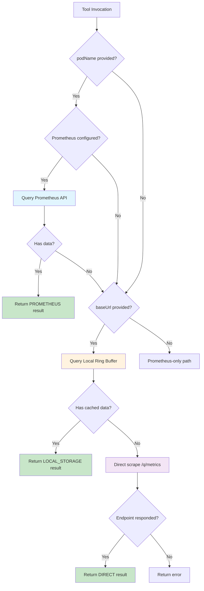
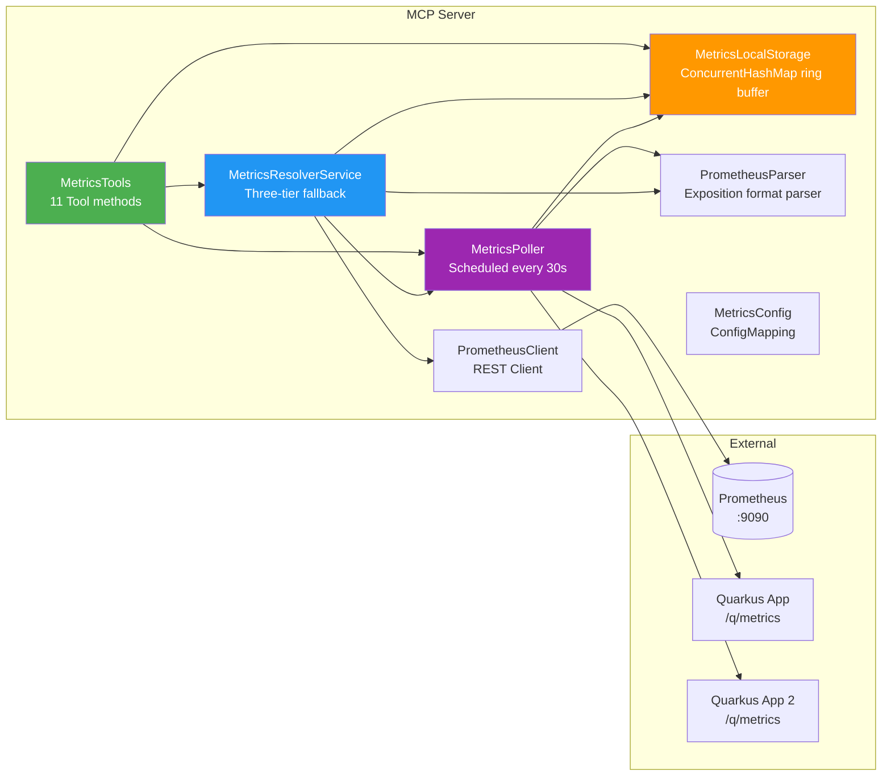
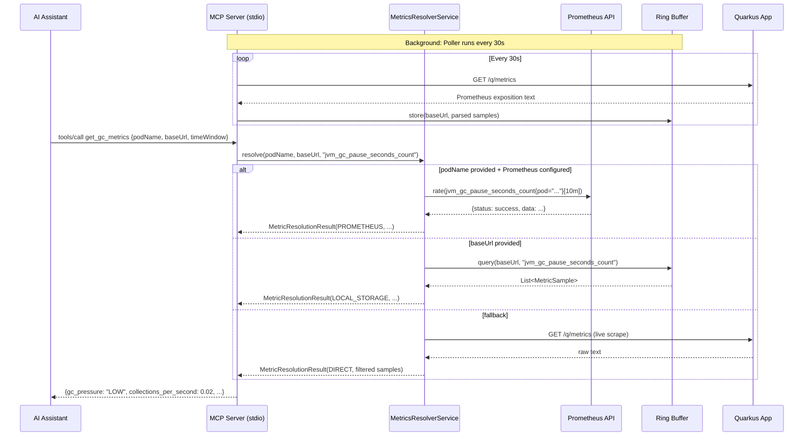
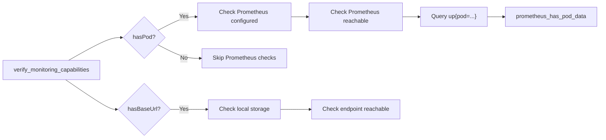
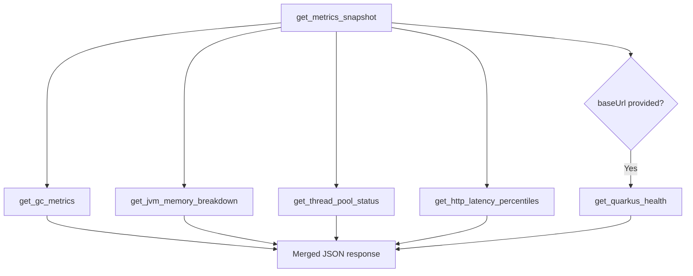

# MCP Server :: Metrics

A unified metrics observability layer for Quarkus applications, exposed as an [MCP (Model Context Protocol)](https://modelcontextprotocol.io) server. Provides 11 tools for JVM diagnostics, HTTP latency analysis, health checks, and raw metric inspection — all accessible to LLM/AI assistants via stdio transport.

## Table of Contents

- [Overview](#overview)
- [Architecture](#architecture)
  - [Three-Tier Fallback Resolution](#three-tier-fallback-resolution)
  - [Component Diagram](#component-diagram)
  - [Data Flow](#data-flow)
- [Key Concepts](#key-concepts)
  - [MCP (Model Context Protocol)](#mcp-model-context-protocol)
  - [Data Sources](#data-sources)
  - [Ring Buffer (Local Storage)](#ring-buffer-local-storage)
  - [Time Window](#time-window)
  - [Prometheus Queries (PromQL)](#prometheus-queries-promql)
  - [Metric Types](#metric-types)
- [Tools Reference](#tools-reference)
  - [1. verify_monitoring_capabilities](#1-verify_monitoring_capabilities)
  - [2. get_gc_metrics](#2-get_gc_metrics)
  - [3. get_jvm_memory_breakdown](#3-get_jvm_memory_breakdown)
  - [4. get_thread_pool_status](#4-get_thread_pool_status)
  - [5. get_http_latency_percentiles](#5-get_http_latency_percentiles)
  - [6. get_quarkus_health](#6-get_quarkus_health)
  - [7. query_metrics_from_prometheus](#7-query_metrics_from_prometheus)
  - [8. fetch_raw_metrics_from_endpoint](#8-fetch_raw_metrics_from_endpoint)
  - [9. get_locally_monitored_apps](#9-get_locally_monitored_apps)
  - [10. get_metrics_from_local_ringbuffer](#10-get_metrics_from_local_ringbuffer)
  - [11. get_metrics_snapshot](#11-get_metrics_snapshot)
- [Prometheus Queries Used](#prometheus-queries-used)
- [Locally Stored Metrics](#locally-stored-metrics)
- [Requirements](#requirements)
- [Building](#building)
- [Running](#running)
  - [Standalone (stdio)](#standalone-stdio)
  - [With Environment Variables](#with-environment-variables)
  - [With Docker/Podman](#with-dockerpodman)
- [Claude Desktop / MCP Client Configuration](#claude-desktop--mcp-client-configuration)
- [Kubernetes Deployment](#kubernetes-deployment)
- [Configuration Reference](#configuration-reference)

---

## Overview

This MCP server bridges the gap between Quarkus application metrics and AI assistants. Instead of requiring users to write PromQL queries or parse raw Prometheus exposition text, the server exposes structured, diagnostic-ready tools that return flat JSON with interpreted values like `gc_pressure: "LOW"`, `heap_utilization_percent: 5.9`, or `latency_status: "HEALTHY"`.

It works in three modes:
1. **With Prometheus** — queries a Prometheus server using PromQL (requires pod name)
2. **With Local Storage** — reads from an in-memory ring buffer populated by background polling
3. **With Direct Scrape** — fetches `/q/metrics` from the application on demand

---

## Architecture

### Three-Tier Fallback Resolution

Every diagnostic tool (GC, memory, threads, HTTP) follows the same resolution strategy:



| Inputs Provided     | Resolution Order                                       |
|---------------------|-------------------------------------------------------|
| `podName + baseUrl` | Prometheus → Local Storage → Direct Scrape            |
| `baseUrl` only      | Local Storage → Direct Scrape                         |
| `podName` only      | Prometheus only                                       |
| Neither             | Error: "Either podName or baseUrl must be provided"   |

### Component Diagram



### Data Flow



---

## Key Concepts

### MCP (Model Context Protocol)

MCP is a standard protocol for connecting AI models to external tools and data sources. This server uses **stdio transport** (stdin/stdout JSON-RPC 2.0) — the AI assistant launches the server as a subprocess and communicates via structured messages. Each `@Tool` method becomes a callable tool that the LLM can invoke.

### Data Sources

| Source | When Used | Requires | Latency | Data Freshness |
|--------|-----------|----------|---------|----------------|
| **PROMETHEUS** | `podName` provided | Prometheus server + pod scrape target | ~50ms network | Real-time (Prometheus scrape interval) |
| **LOCAL_STORAGE** | `baseUrl` provided, cached data exists | Background poller configured | <1ms in-memory | Up to 30s stale (poll interval) |
| **DIRECT** | Fallback when no cache | Application `/q/metrics` reachable | ~20ms network | Real-time (live scrape) |

### Ring Buffer (Local Storage)

The server maintains an in-memory time-series cache per configured application:

```
ConcurrentHashMap<String, Deque<MetricSample>>
  Key:   "http://localhost:4000:jvm_threads_live_threads"
  Value: Deque of MetricSample(name, labels, value, timestamp)
         └── max 120 entries (configurable)
         └── auto-pruned after 900s (configurable)
```

The `MetricsPoller` runs on a `@Scheduled` interval (default 30s), scrapes `/q/metrics` from each configured app, parses the Prometheus exposition text, and stores samples in the buffer. This enables:
- **Rate computation** from counter metrics (GC collections, HTTP requests) using `(latest - earliest) / timeDelta`
- **Freshness filtering** for gauge metrics (memory, threads) — only return data within the requested time window
- **Offline operation** — tools work even if Prometheus is down, as long as the app was recently polled

### Time Window

Most tools accept a `timeWindow` parameter (e.g., `5m`, `10m`, `1h`, `30s`):

| Context | How timeWindow is used |
|---------|----------------------|
| **Prometheus rate()** | PromQL range vector: `rate(metric[10m])` — Prometheus computes per-second rate over the window |
| **Ring buffer counters** | `(last_value - first_value) / time_delta` for samples within the window |
| **Ring buffer gauges** | Filters samples to only return data within `now - timeWindow` |
| **Default** | `10m` if not specified |

### Prometheus Queries (PromQL)

This server uses the same PromQL patterns as the [jvm-mcp](https://github.com/quarkiverse/quarkus-mcp-servers/tree/main/jvm) module:

| Category | Query Pattern | Purpose |
|----------|---------------|---------|
| GC rate | `rate(jvm_gc_pause_seconds_count{pod="..."}[10m])` | Collections per second |
| GC overhead | `rate(jvm_gc_pause_seconds_sum{pod="..."}[10m])` | Fraction of time spent in GC |
| GC max pause | `jvm_gc_pause_seconds_max{pod="..."}` | Maximum pause duration |
| Memory used | `jvm_memory_used_bytes{pod="...",area="heap"}` | Per-area memory usage |
| Memory max | `jvm_memory_max_bytes{pod="..."}` | Per-pool max capacity |
| Heap total | `sum(jvm_memory_used_bytes{pod="...",area="heap"})` | Aggregated heap usage |
| Threads | `jvm_threads_live_threads{pod="..."}` | Current live thread count |
| HTTP p95 | `histogram_quantile(0.95, sum(rate(http_server_requests_seconds_bucket{pod="..."}[10m])) by (le))` | 95th percentile latency |
| HTTP p99 | `histogram_quantile(0.99, sum(rate(http_server_requests_seconds_bucket{pod="..."}[10m])) by (le))` | 99th percentile latency |
| HTTP rate | `sum(rate(http_server_requests_seconds_count{pod="..."}[10m]))` | Requests per second |
| HTTP errors | `sum(rate(http_server_requests_seconds_count{pod="...",status=~"5.."}[10m]))` | 5xx errors per second |
| Pod check | `up{pod="..."}` | Verify Prometheus has data for pod |

### Metric Types

| Type | Behavior | Examples | Rate Computation |
|------|----------|----------|-----------------|
| **Counter** | Monotonically increasing | GC count, HTTP request count | `rate()` in Prometheus, delta/time in ring buffer |
| **Gauge** | Current value, goes up/down | Memory used, thread count | Latest value within window |
| **Histogram** | Cumulative bucket distribution | HTTP latency buckets | `histogram_quantile()` or client-side interpolation |

---

## Tools Reference

### 1. verify_monitoring_capabilities

Checks which data sources are available for a given application.

**Parameters:**
| Name | Required | Description |
|------|----------|-------------|
| `podName` | No | Kubernetes pod name for Prometheus queries |
| `baseUrl` | No | Base URL of the application |

**Flow:**


**Sample Response:**
```json
{
  "timestamp": "2026-08-13T20:09:14.721Z",
  "capabilities": {
    "prometheus_configured": true,
    "prometheus_reachable": true,
    "prometheus_has_pod_data": true,
    "local_storage_has_data": true,
    "endpoint_reachable": true,
    "available_sources": ["PROMETHEUS", "LOCAL_STORAGE", "DIRECT"]
  }
}
```

---

### 2. get_gc_metrics

Returns garbage collection rate metrics with pressure diagnosis.

**Parameters:**
| Name | Required | Description |
|------|----------|-------------|
| `podName` | No | Kubernetes pod name |
| `baseUrl` | No | Application base URL |
| `timeWindow` | No | Rate window (default `10m`) |

**Prometheus Queries:**
```
rate(jvm_gc_pause_seconds_count{pod="..."}[10m])
rate(jvm_gc_pause_seconds_sum{pod="..."}[10m])
jvm_gc_pause_seconds_max{pod="..."}
```

**GC Pressure Thresholds:**
| Overhead | Pressure |
|----------|----------|
| > 10% | `HIGH` |
| > 2% | `MODERATE` |
| ≤ 2% | `LOW` |

**Sample Response:**
```json
{
  "timestamp": "2026-08-13T20:06:42.123Z",
  "time_window": "10m",
  "source": "PROMETHEUS",
  "collectors": [
    {
      "action": "end of minor GC",
      "cause": "G1 Evacuation Pause",
      "collections_per_second": 0.0,
      "estimated_collections": 1,
      "gc_overhead_percent": 0.0,
      "avg_pause_ms": 24.0,
      "max_pause_seconds": 0.024
    },
    {
      "action": "end of minor GC",
      "cause": "Metadata GC Threshold",
      "collections_per_second": 0.0,
      "estimated_collections": 0,
      "gc_overhead_percent": 0.0,
      "max_pause_seconds": 0.0
    }
  ],
  "total_collections_per_second": 0.0,
  "estimated_total_collections": 1,
  "total_gc_overhead_percent": 0.0,
  "gc_pressure": "LOW"
}
```

---

### 3. get_jvm_memory_breakdown

Returns heap and non-heap memory utilization with per-pool saturation.

**Parameters:**
| Name | Required | Description |
|------|----------|-------------|
| `podName` | No | Kubernetes pod name |
| `baseUrl` | No | Application base URL |
| `timeWindow` | No | Freshness window (default `10m`) |

**Prometheus Queries:**
```
sum(jvm_memory_used_bytes{pod="...",area="heap"})
sum(jvm_memory_max_bytes{pod="...",area="heap"})
sum(jvm_memory_used_bytes{pod="...",area="nonheap"})
jvm_memory_used_bytes{pod="..."}
jvm_memory_max_bytes{pod="..."}
```

**Sample Response:**
```json
{
  "timestamp": "2026-08-13T20:07:01.456Z",
  "time_window": "10m",
  "source": "PROMETHEUS",
  "heap_used_bytes": 555304448,
  "heap_max_bytes": 9403629568,
  "heap_utilization_percent": 5.9,
  "nonheap_used_bytes": 76375024,
  "pools": [
    {
      "pool_name": "G1 Old Gen",
      "area": "heap",
      "used_bytes": 118270464,
      "max_bytes": 9403629568,
      "utilization_percent": 1.26
    },
    {
      "pool_name": "G1 Eden Space",
      "area": "heap",
      "used_bytes": 436207616,
      "max_bytes": -1
    },
    {
      "pool_name": "G1 Survivor Space",
      "area": "heap",
      "used_bytes": 1046784,
      "max_bytes": -1
    },
    {
      "pool_name": "Metaspace",
      "area": "nonheap",
      "used_bytes": 47086160,
      "max_bytes": -1
    },
    {
      "pool_name": "CodeHeap 'profiled nmethods'",
      "area": "nonheap",
      "used_bytes": 12923008,
      "max_bytes": 122908672,
      "utilization_percent": 10.51
    },
    {
      "pool_name": "Compressed Class Space",
      "area": "nonheap",
      "used_bytes": 5549856,
      "max_bytes": 1073741824,
      "utilization_percent": 0.52
    },
    {
      "pool_name": "CodeHeap 'non-nmethods'",
      "area": "nonheap",
      "used_bytes": 1361664,
      "max_bytes": 5840896,
      "utilization_percent": 23.31
    },
    {
      "pool_name": "CodeHeap 'non-profiled nmethods'",
      "area": "nonheap",
      "used_bytes": 9454336,
      "max_bytes": 122908672,
      "utilization_percent": 7.7
    }
  ]
}
```

---

### 4. get_thread_pool_status

Returns thread counts and optional executor pool metrics.

**Parameters:**
| Name | Required | Description |
|------|----------|-------------|
| `podName` | No | Kubernetes pod name |
| `baseUrl` | No | Application base URL |
| `timeWindow` | No | Freshness window (default `10m`) |

**Prometheus Queries:**
```
jvm_threads_live_threads{pod="..."}
jvm_threads_daemon_threads{pod="..."}
jvm_threads_peak_threads{pod="..."}
executor_queued_tasks{pod="..."}
executor_active_threads{pod="..."}
executor_pool_size_threads{pod="..."}
```

**Sample Response:**
```json
{
  "timestamp": "2026-08-13T20:07:22.789Z",
  "time_window": "10m",
  "source": "PROMETHEUS",
  "live_threads": 39,
  "daemon_threads": 8,
  "peak_threads": 238,
  "non_daemon_threads": 31,
  "peak_utilization_percent": 16.39
}
```

---

### 5. get_http_latency_percentiles

Returns p95/p99 latency, request rate, and error rates.

**Parameters:**
| Name | Required | Description |
|------|----------|-------------|
| `podName` | No | Kubernetes pod name |
| `baseUrl` | No | Application base URL |
| `uri` | No | URI pattern filter (e.g., `/api/users`) |
| `timeWindow` | No | Rate window (default `10m`) |

**Prometheus Queries (when podName provided):**
```
histogram_quantile(0.95, sum(rate(http_server_requests_seconds_bucket{pod="..."}[10m])) by (le))
histogram_quantile(0.99, sum(rate(http_server_requests_seconds_bucket{pod="..."}[10m])) by (le))
sum(rate(http_server_requests_seconds_count{pod="..."}[10m]))
sum(rate(http_server_requests_seconds_count{pod="...",status=~"5.."}[10m]))
```

**Latency Status Thresholds:**
| p95 Latency | Status |
|-------------|--------|
| > 1.0s | `CRITICAL` |
| > 0.5s | `DEGRADED` |
| ≤ 0.5s | `HEALTHY` |

**Sample Response (Prometheus):**
```json
{
  "timestamp": "2026-08-13T20:08:01.234Z",
  "time_window": "10m",
  "source": "PROMETHEUS",
  "p95_latency_seconds": 0.03,
  "p95_latency_ms": 27.57,
  "p99_latency_seconds": 0.03,
  "p99_latency_ms": 31.26,
  "request_rate_per_sec": 0.22,
  "latency_status": "HEALTHY"
}
```

**Sample Response (Local/Direct — bucket computation):**
```json
{
  "timestamp": "2026-08-13T20:08:15.567Z",
  "time_window": "10m",
  "source": "LOCAL_STORAGE",
  "p95_latency_seconds": 0.02,
  "p95_latency_ms": 19.84,
  "p99_latency_seconds": 0.03,
  "p99_latency_ms": 28.12,
  "total_requests": 13408887,
  "avg_latency_seconds": 0.0,
  "avg_latency_ms": 0.22,
  "error_count_5xx": 0,
  "latency_status": "HEALTHY",
  "note": "Percentiles computed from cumulative histogram buckets (all-time, not windowed)."
}
```

---

### 6. get_quarkus_health

Fetches application health status from Quarkus health endpoints.

**Parameters:**
| Name | Required | Description |
|------|----------|-------------|
| `baseUrl` | Yes | Base URL of the application |

**Endpoints queried:**
- `{baseUrl}/q/health`
- `{baseUrl}/q/health/live`
- `{baseUrl}/q/health/ready`

**Sample Response:**
```json
{
  "timestamp": "2026-08-13T20:08:30.123Z",
  "base_url": "http://localhost:4000",
  "health": {"status": "UP", "checks": []},
  "liveness": {"status": "UP", "checks": []},
  "readiness": {"status": "UP", "checks": []}
}
```

---

### 7. query_metrics_from_prometheus

Executes a raw PromQL query and returns the full Prometheus API response.

**Parameters:**
| Name | Required | Description |
|------|----------|-------------|
| `query` | Yes | PromQL query string |

**Sample Response:**
```json
{
  "status": "success",
  "data": {
    "resultType": "vector",
    "result": [
      {
        "metric": {
          "__name__": "jvm_threads_live_threads",
          "pod": "tfb-qrh-sample-7d6d7cd77-zh2dp",
          "namespace": "default"
        },
        "value": [1786651573.286, "39"]
      }
    ]
  }
}
```

---

### 8. fetch_raw_metrics_from_endpoint

Scrapes `/q/metrics` and returns all metrics as flat key-value JSON.

**Parameters:**
| Name | Required | Description |
|------|----------|-------------|
| `baseUrl` | Yes | Base URL of the application |

**Sample Response (truncated):**
```json
{
  "timestamp": "2026-08-13T20:09:32.907Z",
  "base_url": "http://localhost:4000",
  "total_metrics": 1320,
  "metrics": {
    "jvm_threads_live_threads{registry=prometheus,env=prod}": 39.0,
    "jvm_memory_used_bytes{area=heap,id=G1 Old Gen,registry=prometheus,env=prod}": 118270464.0,
    "jvm_gc_pause_seconds_count{action=end of minor GC,cause=G1 Evacuation Pause,registry=prometheus,env=prod}": 469.0,
    "http_server_requests_seconds_count{method=GET,uri=/db,outcome=SUCCESS,status=200,registry=prometheus,env=prod}": 4123456.0
  }
}
```

---

### 9. get_locally_monitored_apps

Lists all applications configured for local metrics monitoring.

**Parameters:** None.

**Sample Response:**
```json
{
  "timestamp": "2026-08-13T20:09:44.781Z",
  "polling_enabled": true,
  "poll_interval_seconds": 30,
  "apps": [
    {
      "base_url": "http://localhost:4000",
      "has_cached_data": true,
      "endpoint_reachable": true
    }
  ],
  "total_apps": 1
}
```

---

### 10. get_metrics_from_local_ringbuffer

Returns cached time-series data from the in-memory ring buffer.

**Parameters:**
| Name | Required | Description |
|------|----------|-------------|
| `baseUrl` | Yes | Base URL of the application |
| `timeWindow` | No | Filter window (default `10m`) |

**Sample Response (truncated):**
```json
{
  "timestamp": "2026-08-13T20:10:16.327Z",
  "base_url": "http://localhost:4000",
  "time_window": "10m",
  "has_data": true,
  "total_samples": 645,
  "metrics": {
    "jvm_threads_live_threads{registry=prometheus,env=prod}": {
      "value": 39.0,
      "timestamp_ms": 1786651815109
    },
    "system_cpu_usage{registry=prometheus,env=prod}": {
      "value": 0.012344,
      "timestamp_ms": 1786651815109
    },
    "jvm_memory_used_bytes{area=heap,id=G1 Old Gen,registry=prometheus,env=prod}": {
      "value": 118270464.0,
      "timestamp_ms": 1786651815109
    }
  }
}
```

---

### 11. get_metrics_snapshot

Comprehensive snapshot combining GC + memory + threads + HTTP + health.

**Parameters:**
| Name | Required | Description |
|------|----------|-------------|
| `podName` | No | Kubernetes pod name |
| `baseUrl` | No | Application base URL |
| `timeWindow` | No | Window for all sub-tools (default `10m`) |

**Flow:**


**Sample Response (truncated):**
```json
{
  "timestamp": "2026-08-13T20:10:23.659Z",
  "time_window": "10m",
  "pod_name": "tfb-qrh-sample-7d6d7cd77-zh2dp",
  "base_url": "http://localhost:4000",
  "gc": {
    "source": "PROMETHEUS",
    "gc_pressure": "LOW",
    "total_collections_per_second": 0.0,
    "collectors": [
      {"action": "end of minor GC", "cause": "G1 Evacuation Pause", "collections_per_second": 0.0, "avg_pause_ms": 24.0}
    ]
  },
  "memory": {
    "source": "PROMETHEUS",
    "heap_used_bytes": 178037504,
    "heap_max_bytes": 9403629566,
    "heap_utilization_percent": 1.89,
    "pools": [
      {"pool_name": "G1 Old Gen", "area": "heap", "used_bytes": 118270464, "utilization_percent": 1.26}
    ]
  },
  "threads": {
    "source": "PROMETHEUS",
    "live_threads": 39,
    "daemon_threads": 8,
    "peak_threads": 238
  },
  "http": {
    "source": "PROMETHEUS",
    "p95_latency_ms": 27.88,
    "p99_latency_ms": 48.37,
    "request_rate_per_sec": 0.24,
    "latency_status": "HEALTHY"
  },
  "health": {
    "health": {"status": "UP"},
    "liveness": {"status": "UP"},
    "readiness": {"status": "UP"}
  }
}
```

---

## Prometheus Queries Used

Complete reference of all PromQL queries executed by this server:

### Garbage Collection
| Query | Tool | Purpose |
|-------|------|---------|
| `rate(jvm_gc_pause_seconds_count{pod="P"}[W])` | `get_gc_metrics` | GC collections per second |
| `rate(jvm_gc_pause_seconds_sum{pod="P"}[W])` | `get_gc_metrics` | Time fraction spent in GC |
| `jvm_gc_pause_seconds_max{pod="P"}` | `get_gc_metrics` | Maximum GC pause duration |

### Memory
| Query | Tool | Purpose |
|-------|------|---------|
| `sum(jvm_memory_used_bytes{pod="P",area="heap"})` | `get_jvm_memory_breakdown` | Total heap used |
| `sum(jvm_memory_max_bytes{pod="P",area="heap"})` | `get_jvm_memory_breakdown` | Total heap max |
| `sum(jvm_memory_used_bytes{pod="P",area="nonheap"})` | `get_jvm_memory_breakdown` | Total non-heap used |
| `jvm_memory_used_bytes{pod="P"}` | `get_jvm_memory_breakdown` | Per-pool usage |
| `jvm_memory_max_bytes{pod="P"}` | `get_jvm_memory_breakdown` | Per-pool max |

### Threads
| Query | Tool | Purpose |
|-------|------|---------|
| `jvm_threads_live_threads{pod="P"}` | `get_thread_pool_status` | Live thread count |
| `jvm_threads_daemon_threads{pod="P"}` | `get_thread_pool_status` | Daemon thread count |
| `jvm_threads_peak_threads{pod="P"}` | `get_thread_pool_status` | Peak thread count |
| `executor_queued_tasks{pod="P"}` | `get_thread_pool_status` | Executor queue depth |
| `executor_active_threads{pod="P"}` | `get_thread_pool_status` | Executor active threads |
| `executor_pool_size_threads{pod="P"}` | `get_thread_pool_status` | Executor pool size |

### HTTP Latency
| Query | Tool | Purpose |
|-------|------|---------|
| `histogram_quantile(0.95, sum(rate(http_server_requests_seconds_bucket{pod="P"}[W])) by (le))` | `get_http_latency_percentiles` | p95 latency |
| `histogram_quantile(0.99, sum(rate(http_server_requests_seconds_bucket{pod="P"}[W])) by (le))` | `get_http_latency_percentiles` | p99 latency |
| `sum(rate(http_server_requests_seconds_count{pod="P"}[W]))` | `get_http_latency_percentiles` | Request rate |
| `sum(rate(http_server_requests_seconds_count{pod="P",status=~"5.."}[W]))` | `get_http_latency_percentiles` | 5xx error rate |

### Monitoring Verification
| Query | Tool | Purpose |
|-------|------|---------|
| `up` | `verify_monitoring_capabilities` | Prometheus reachability |
| `up{pod="P"}` | `verify_monitoring_capabilities` | Pod data exists check |

> `P` = pod name, `W` = time window (default `10m`)

---

## Locally Stored Metrics

The background poller scrapes and stores **all** metrics from the `/q/metrics` endpoint. Key metrics used by the diagnostic tools:

| Metric Name | Type | Labels | Used By |
|-------------|------|--------|---------|
| `jvm_gc_pause_seconds_count` | Counter | `action`, `cause` | `get_gc_metrics` |
| `jvm_gc_pause_seconds_sum` | Counter | `action`, `cause` | `get_gc_metrics` |
| `jvm_memory_used_bytes` | Gauge | `area`, `id` | `get_jvm_memory_breakdown` |
| `jvm_threads_live_threads` | Gauge | — | `get_thread_pool_status` |
| `jvm_threads_daemon_threads` | Gauge | — | `get_thread_pool_status` |
| `jvm_threads_peak_threads` | Gauge | — | `get_thread_pool_status` |
| `http_server_requests_seconds_bucket` | Histogram | `le`, `method`, `uri`, `status` | `get_http_latency_percentiles` |
| `http_server_requests_seconds_count` | Counter | `method`, `uri`, `status` | `get_http_latency_percentiles` |
| `http_server_requests_seconds_sum` | Counter | `method`, `uri`, `status` | `get_http_latency_percentiles` |
| `executor_queued_tasks` | Gauge | — | `get_thread_pool_status` |
| `system_cpu_usage` | Gauge | — | `get_metrics_from_local_ringbuffer` |

---

## Requirements

- **Java 17+** (tested with Java 21)
- **Maven 3.9+** for building
- **Quarkus 3.x** (managed by parent POM)
- **Target application** must expose `/q/metrics` (Micrometer Prometheus registry)
  - Add `quarkus-micrometer-registry-prometheus` to your Quarkus app
- **Prometheus** (optional) — needed only for pod-based queries
- **Docker/Podman** (optional) — for container deployment

### Target Application Setup

Ensure your Quarkus application has Micrometer Prometheus enabled:

```xml
<dependency>
    <groupId>io.quarkus</groupId>
    <artifactId>quarkus-micrometer-registry-prometheus</artifactId>
</dependency>
```

```properties
# application.properties
quarkus.micrometer.export.prometheus.enabled=true
quarkus.micrometer.binder.jvm=true
quarkus.micrometer.binder.http-server.enabled=true
```

---

## Building

```bash
# From the quarkus-mcp-servers root directory
cd quarkus-mcp-servers
mvn clean package -DskipTests -pl metrics -am

# The uber-jar is at:
# metrics/target/mcp-server-metrics-999-SNAPSHOT.jar
```

---

## Running

### Standalone (stdio)

The server communicates via stdin/stdout (JSON-RPC 2.0 over MCP protocol):

```bash
java -jar metrics/target/mcp-server-metrics-999-SNAPSHOT.jar
```

### With Environment Variables

```bash
# Point to your Prometheus and target apps
export PROMETHEUS_URL=http://prometheus.example.com:9090
export METRICS_APPS=http://app1:8080,http://app2:8080

java -jar metrics/target/mcp-server-metrics-999-SNAPSHOT.jar
```

### With Docker/Podman

```bash
# Pull the pre-built image
podman pull quay.io/rh-ee-shesaxen/quarkus-mcp:bobathon

# Run with environment variables
podman run --rm \
  -e PROMETHEUS_URL=http://host.containers.internal:9090 \
  -e METRICS_APPS=http://host.containers.internal:4000 \
  -i quay.io/rh-ee-shesaxen/quarkus-mcp:bobathon
```

---

## Claude Desktop / MCP Client Configuration

Add to your Claude Desktop `claude_desktop_config.json` or VS Code MCP settings:

### Local JAR

```json
{
  "mcpServers": {
    "quarkus-metrics": {
      "command": "java",
      "args": ["-jar", "/path/to/mcp-server-metrics-999-SNAPSHOT.jar"],
      "env": {
        "PROMETHEUS_URL": "http://localhost:9090",
        "METRICS_APPS": "http://localhost:8080"
      }
    }
  }
}
```

### Container Image

```json
{
  "mcpServers": {
    "quarkus-metrics": {
      "command": "podman",
      "args": [
        "run", "--rm", "-i",
        "-e", "PROMETHEUS_URL=http://host.containers.internal:9090",
        "-e", "METRICS_APPS=http://host.containers.internal:8080",
        "quay.io/rh-ee-shesaxen/quarkus-mcp:bobathon"
      ]
    }
  }
}
```

### Multiple Applications

```json
{
  "mcpServers": {
    "quarkus-metrics": {
      "command": "java",
      "args": ["-jar", "/path/to/mcp-server-metrics-999-SNAPSHOT.jar"],
      "env": {
        "PROMETHEUS_URL": "http://prometheus:9090",
        "METRICS_APPS": "http://app1:8080,http://app2:8080,http://app3:8080"
      }
    }
  }
}
```

---

## Kubernetes Deployment

See [`deploy/`](deploy/) directory for ready-to-use manifests:

- `configmap.yaml` — All configuration in a single ConfigMap
- `deployment.yaml` — Deployment with stdio transport
- `kustomization.yaml` — Kustomize overlay

### Quick Deploy

```bash
# Edit the ConfigMap with your Prometheus URL and app endpoints
kubectl apply -f deploy/

# Or with kustomize
kubectl apply -k deploy/
```

### Environment Variables

| Variable | Default | Description |
|----------|---------|-------------|
| `PROMETHEUS_URL` | `http://localhost:9090` | Prometheus server URL |
| `METRICS_APPS` | `http://localhost:4000` | Comma-separated list of Quarkus app base URLs to poll |
| `JAVA_OPTS` | (none) | Additional JVM options (e.g., `-Xmx256m`) |

---

## Configuration Reference

All configuration is under the `metrics.*` prefix and can be set via `application.properties`, environment variables, or system properties.

| Property | Env Variable | Default | Description |
|----------|-------------|---------|-------------|
| `metrics.prometheus-url` | `PROMETHEUS_URL` | `http://localhost:9090` | Prometheus API base URL |
| `metrics.apps` | `METRICS_APPS` | `http://localhost:4000` | Comma-separated app base URLs |
| `metrics.connect-timeout-seconds` | — | `5` | HTTP connect timeout |
| `metrics.read-timeout-seconds` | — | `10` | HTTP read timeout |
| `metrics.poll.enabled` | — | `true` | Enable background polling |
| `metrics.poll.interval` | — | `30s` | Polling interval |
| `metrics.store.retention-seconds` | — | `900` (15 min) | Ring buffer data retention |
| `metrics.store.max-samples` | — | `120` | Max samples per metric in ring buffer |
